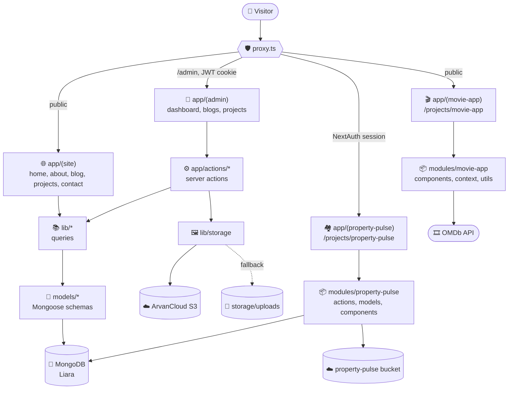
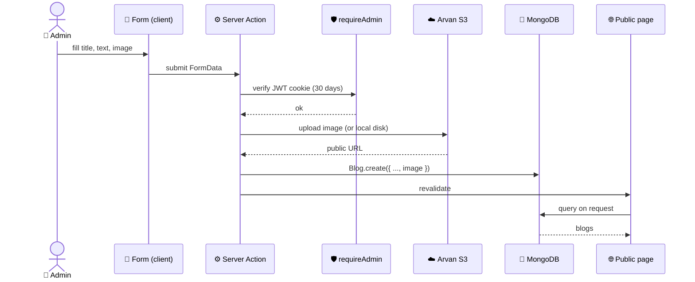

<div align="center">

# 👨‍💻 amirmohammad-dev

Personal portfolio, blog and live project showcase

[](https://amirmohammad-dev.ir/)


</div>

---

## ✨ Features

- 🏠 Minimal home page with a dark / light theme toggle (dark by default)
- 📝 Blog with Markdown posts, cover images and search
- 🧩 Projects page: external projects open GitHub / demo, embedded projects run inside the site
- 🔐 Admin panel (`/admin`) to create, edit and delete blogs and projects
- 📬 Contact form with an admin inbox
- 🏘️ **property-pulse** (Next.js + NextAuth + MongoDB) embedded at `/projects/property-pulse`
- 🎬 **movie-app** (OMDb search) embedded at `/projects/movie-app`
- 🖼️ Image uploads to ArvanCloud S3, or local disk as a fallback

---

## 🗺️ Architecture



### 🧱 Route groups

Each route group has its own root layout, so every section keeps its own look and providers.

| Group | Path | Purpose |
| --- | --- | --- |
| `app/(site)` | `/`, `/about`, `/blog`, `/projects`, `/contact` | Public portfolio, theme toggle |
| `app/(admin)` | `/admin/*` | Admin panel |
| `app/(property-pulse)` | `/projects/property-pulse/*` | Isolated rental marketplace |
| `app/(movie-app)` | `/projects/movie-app/*` | Isolated movie search app |

### 📁 Folder structure

```text
my-portfolio/
├── app/
│   ├── (site)/              public pages
│   ├── (admin)/             admin pages
│   ├── (property-pulse)/    property-pulse routes + own layout
│   ├── (movie-app)/         movie-app routes + own layout
│   ├── actions/             portfolio server actions (auth, blog, project, contact)
│   ├── api/                 property-pulse auth, movie-app search
│   └── media/               serves locally stored uploads
├── components/              admin, blog, contact, layout, project, theme, ui
├── models/                  Blog, Project, ContactMessage (Mongoose)
├── lib/                     queries, auth (JWT), storage, helpers
├── config/                  database.ts, storage.ts
├── modules/
│   ├── property-pulse/      actions, components, models, utils, ...
│   └── movie-app/           components, context, types, utils
├── scripts/seed.mjs         sample data
└── proxy.ts                 route protection
```

---

## 🗄️ How the backend and database work

There is no separate backend server. Next.js is the backend: **Server Components** read data, **Server Actions** write it, and a few **Route Handlers** cover what actions cannot.



| Layer | Where | Role |
| --- | --- | --- |
| 🧬 Models | `models/` | Mongoose schemas for blogs, projects, contact messages |
| 📚 Queries | `lib/*/queries.ts` | Read helpers used by Server Components |
| ⚙️ Actions | `app/actions/*` | Create, update, delete, validated and admin-only |
| 🔌 Connection | `config/database.ts` | Cached Mongoose connection |
| 🖼️ Storage | `lib/storage` | Arvan S3 upload, local fallback served by `/media/*` |
| 🔐 Auth | `lib/auth`, `proxy.ts` | Username and password from env, signed JWT cookie valid for 30 days |

### 🔑 Two separate auth systems

- **Portfolio admin**: username and password in `.env`, signed JWT cookie (`jose`), guarded for `/admin/*`.
- **property-pulse users**: GitHub OAuth through NextAuth, guarded for add, saved and profile pages.

### 🧩 Project kinds

- `external`: the card opens the GitHub or demo link.
- `embedded`: the card opens `internal_path` (for example `/projects/movie-app`) inside this site.

Projects are stored in MongoDB, so new ones can be added from `/admin/projects/new` without a deploy.

---

## 🚀 Getting started

```bash
npm install
npm run seed
npm run dev
```

Open http://localhost:3000.

### 🔧 Environment

- `.env.development` is used by `npm run dev`, `.env` by build and start.
- `MONGODB_URI`, `MONGODB_DB_NAME`
- `ADMIN_USERNAME`, `ADMIN_PASSWORD`, `ADMIN_SESSION_SECRET`
- `PORTFOLIO_S3_*`: bucket for blog and project images (leave empty to store locally)
- `ARVAN_CLOUD_S3_*`: property-pulse bucket
- `GITHUB_AUTH_CLIENT_ID`, `GITHUB_AUTH_CLIENT_SECRET`, `NEXTAUTH_SECRET`, `NEXTAUTH_URL`
- `NEXT_PUBLIC_SITE_URL`, `NEXT_PUBLIC_DOMAIN`, `NEXT_PUBLIC_API_DOMAIN`, `NEXT_PUBLIC_MAP_GEOCODING`
- `OMDB_API_KEY`: movie-app

> ⚠️ Never commit real secrets. Keep `.env*` files out of git.

---

## ☁️ Deployment

- 🌐 Hosting: Liara (Next.js platform), deployed from GitHub
- 🍃 Database: MongoDB on Liara (private network host)
- 🖼️ Images: ArvanCloud object storage
- 🔗 Domain: `amirmohammad-dev.ir`
- `next.config.mjs` must stay `.mjs` so Liara's standalone rewrite keeps `remotePatterns`

---

## 📬 Contact

[](https://github.com/amirmohammad017)
[](https://linkedin.com/in/amirmohammad-dev)
[](https://t.me/AMiRmohammaD017)
[](mailto:amirm.1774@gmail.com)
